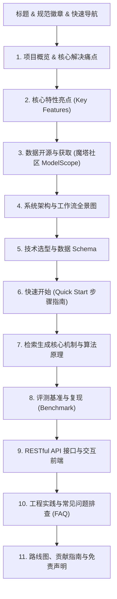

# 实施计划：基于默沙东医疗问答 Graph RAG 系统 README 深度优化与数据上传

## 1. 任务背景与目标
针对本项目进行开源级 README 深度重构优化并上传数据至魔塔社区：
- **项目标题**：统一命名为《基于默沙东医疗问答 Graph RAG 系统》。
- **开源标准**：遵循国际顶级开源项目的规范，包含精美徽章栏、架构可视化流程、详细技术栈、保姆级上手指南、算法细节、API 文档、评测指标、排错指南与免责声明。
- **数据开源与魔塔社区**：重点突出数据集开源至魔塔社区（ModelScope），提供配置指南，使用占位符保护私密凭证。
- **凭证安全规范**：严禁在公开代码与文档中暴露用户的真实 API Key/Token。
- **数据上传魔塔**：利用用户配置的魔塔社区凭证，将医疗问答数据（Professional.json 及相关提取数据）上传同步至魔塔社区数据集仓库。
- **语言与规范**：遵循全中文交互、中文思考过程以及中文注释和文档规范。

## 2. README 章节架构设计

## 3. 执行步骤
1. 完成 README 与任务文档的敏感 Key 彻底脱敏。
2. 使用 `git commit --amend` 覆盖前次提交，并强制推送到 GitHub 远端消除泄露历史。
3. 安装配置 `modelscope` SDK，使用用户 Token 连接并上传 data 相关数据至魔塔社区数据集。
4. 校验魔塔数据集并更新文档中的仓库引用。
